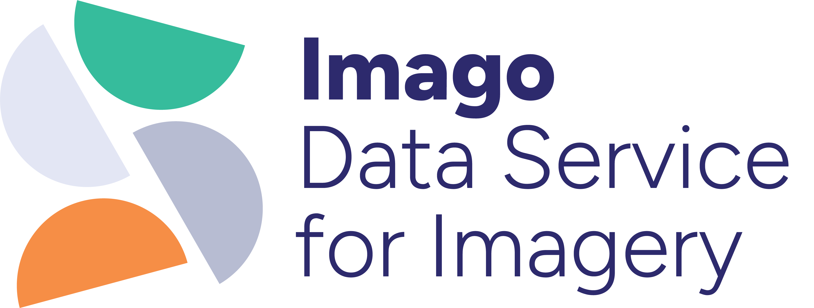

# From Pixels to Policy: An Earth Observation Hackathon

Website and materials for **From Pixels to Policy: An Earth Observation Hackathon**, a one-day event on urban heat and greenspace in Newcastle and the North East (**Wednesday 9 December 2026, 10:00–16:00**).

Organised by [Imago: Data Service for Imagery](https://imago.ac.uk/) in collaboration with the [Earth Observation Data Hub (EODH)](https://eodatahub.org.uk/) and the North East Data Network at [Insights North East (INE)](https://insightsnortheast.co.uk/).

🌐 **Website:** <https://imago-sdruk.github.io/Imago-EODH-Hack-2026>
🎟️ **Register:** [Eventbrite](https://www.eventbrite.com/e/from-pixels-to-policy-an-earth-observation-hackathon-tickets-2003542936858)


## 🧱 Building the website

The site is a [Quarto](https://quarto.org/) book styled after the Imago [Book of Imagery](https://github.com/Imago-SDRUK/boi): Quarto's `cosmo` theme with a light Imago touch (`imago.scss`). The rendered site is written to `docs/` and served with GitHub Pages.

```bash
quarto preview     # live preview while editing
quarto render      # build the site into docs/ (commit docs/ with your changes)
```

Outstanding items for the organisers are listed in [`TODO.md`](TODO.md).


## 🗂️ Repository Structure

- `_quarto.yml` — site configuration and chapter order
- `*.qmd` — website pages (welcome, overview, the day, preparation, EODH set-up, challenges, case study, data, outputs, resources, references)
- `imago.scss` — light Imago website theme (palette, Figtree font)
- `imago-slides.scss` — Imago Reveal.js theme for presentations
- `Imago-EODH-Hack-2026.Rproj` — RStudio project
- `docs/` — rendered website (generated by `quarto render`)
- `assets/` — images, logos and other media files
- `.github/` — community health files (issue/PR templates)
- `TODO.md` — organiser checklist
- `CONTRIBUTING.md` — how to contribute to this project
- `CODE_OF_CONDUCT.md` — community standards and expectations
- `LICENSE` — licensing information


## 🛠️ Contributing

We welcome contributions of all kinds: resources, code, documentation, ideas and more.
Please read our [Contributing Guidelines](CONTRIBUTING.md) for step-by-step instructions on how to:

- Fork and clone the repository
- Create a new branch for your changes
- Use issue and pull request templates
- Get acknowledged with the All Contributors Bot
- Resolve merge conflicts

If you have questions, open an issue or start a discussion!


## 🙋 License

This repository uses a dual-licensing approach:

- **MIT License** for all software code (see [LICENSE](LICENSE))
- **Creative Commons Attribution 4.0 International (CC BY 4.0)** for documentation, data, and non-code content

See the [LICENSE](LICENSE) file for full details.


## 🎉 Acknowledging Contributors

We use the [All Contributors Bot](https://allcontributors.org/) to recognise everyone's work: code, docs, ideas, design and more.
After your PR is merged, comment on an issue or PR:

```
@all-contributors please add @your-username for code, doc, etc.
```
(Replace `@your-username` and the contribution types as appropriate.)
See the [emoji key](https://allcontributors.org/docs/en/emoji-key) for available contribution types.

<!-- ALL-CONTRIBUTORS-LIST:START - Do not remove or modify this section -->
<!-- prettier-ignore-start -->
<!-- markdownlint-disable -->

<!-- markdownlint-restore -->
<!-- prettier-ignore-end -->

<!-- ALL-CONTRIBUTORS-LIST:END -->
